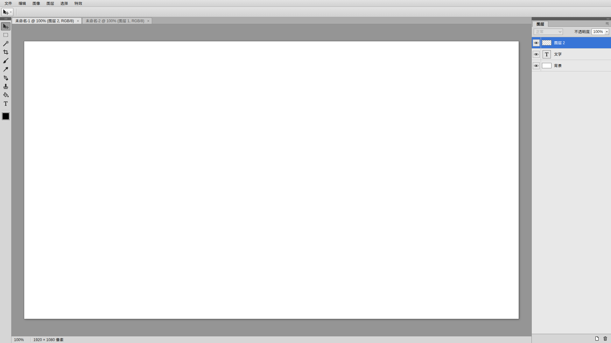

# open-ps

open-ps 是一个从零开始（greenfield）的浏览器修图工具：**界面与手感参照 Photoshop CS5，概念模型保持简单**——一个文档就是一组像素图层，只有一个前景色，核心卖点是基于 PatchMatch 的智能填充（内容识别填充）。简体中文界面，以静态 zip 包发布到 B 站 Toy。

> 当前状态：**Step 2 — CS5 空壳 UI**。菜单、工具栏、选项栏、标签页、图层面板与对话框都已就位，但还没有任何真实的图像处理（数据均为 mock）。

## 开发

需要 Node 22.12+ 与 npm。

```bash
npm install
npm run dev        # 开发服务器
npm run lint       # ESLint + Prettier 检查
npm run typecheck  # vue-tsc
npm test           # Vitest 单元测试
npm run build      # 产物输出到 dist/（相对路径，可部署在任意子路径）
npm run pack       # 构建并打包为 release/open-ps-<version>.zip
```



## 文档

| 文档 | 内容 |
| --- | --- |
| [docs/PRODUCT.md](docs/PRODUCT.md) | 产品目标与非目标、菜单与工具清单、快捷键、UX 约束、分阶段 MVP、Toy 打包 |
| [docs/ARCHITECTURE.md](docs/ARCHITECTURE.md) | 技术选型（Vue 3 + Vite + TypeScript + Pinia，Canvas 2D + Web Workers）、目录结构、文档/图层/选区/历史模型、渲染、Worker 边界、测试与构建 |
| [docs/ROADMAP.md](docs/ROADMAP.md) | 小步路线图：Step 1 文档 → Step 2 CS5 空壳 UI → 文档模型、视口、选区、工具、智能填充、特效、导出 → v1.0 |

## 一览

- 菜单：文件、编辑、图像、图层、选择、特效
- 工具：移动 V、选择 M、魔棒 W、裁剪 C、画笔 B、吸管 I、钢笔 P、仿制 S、填充 G、文字 T
- 技术：Vue 3 · Vite · TypeScript · Pinia · Canvas 2D · OffscreenCanvas · Web Workers（不使用 UI 组件库，外壳自绘）

## 说明

open-ps 是独立的全新实现，不包含 BitMappery 的代码，也不使用 Adobe 的图标或素材；"Photoshop CS5"只用作交互参照。
